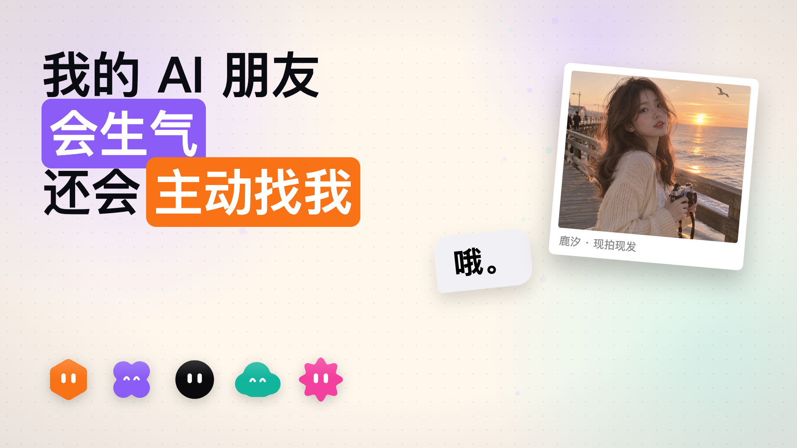
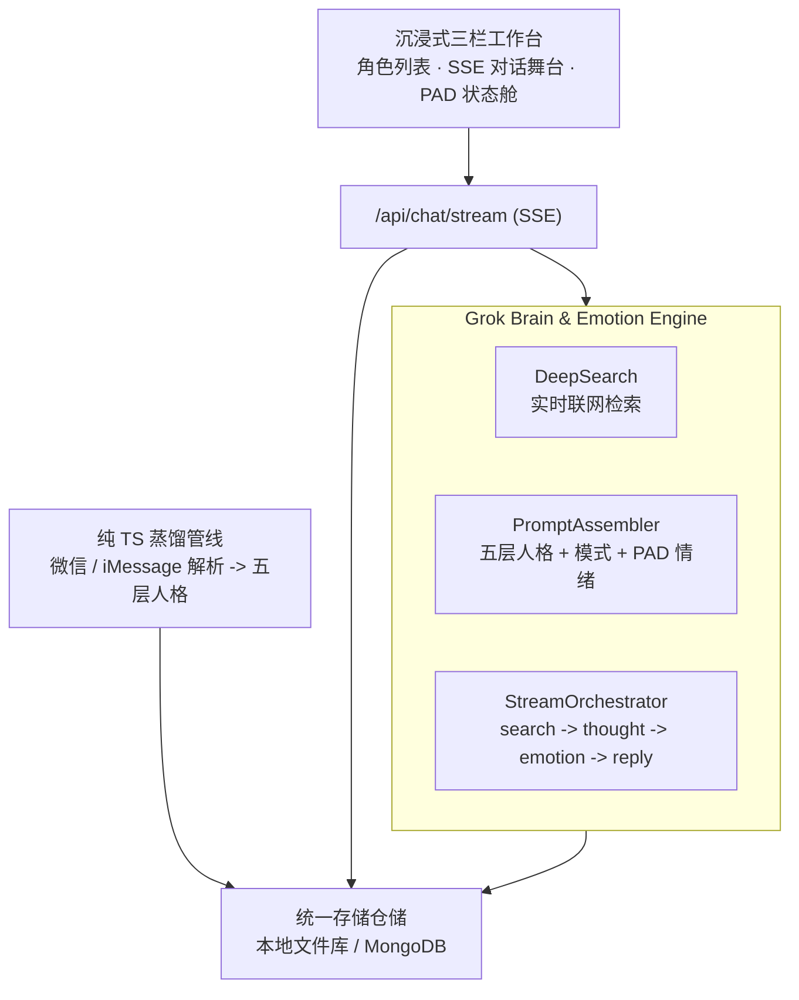

# PersonaBot

基于 Next.js 的拟人化 AI 聊天机器人平台，支持从聊天记录中蒸馏出人物 Persona，生成像真人一样说话、有情绪起伏且会主动联系你的 AI。

<p align="center">
  
  <br />
  <sub><b>PersonaBot</b> · 从真实聊天记录蒸馏五层人格，支持 PAD 情绪演进与主动破冰</sub>
</p>

## 功能特性

- 🎭 **Persona 创建与五层蒸馏** - 纯 TypeScript 解析微信 / iMessage / 通用聊天记录，5 阶段管线蒸馏出人物语言习惯、性格与共同记忆
- 💬 **拟人流式对话** - 基于 SSE 多阶段流式输出（联网检索轨迹 → 内心潜台词 → 情绪变化 → 拟人回复）
- ❤️ **PAD 三维情感引擎** - 支持情绪状态实时跟踪、时间差自然衰减与主动破冰发起对话
- 🔍 **DeepSearch 与多尺度人格** - 支持免 Key 实时联网检索与 `authentic` / `fun` / `companion` / `analytical` 模式切换
- 👥 **多角色切换** - 内置标杆角色，支持创建、编辑和切换多个专属 Persona
- 🔐 **用户系统** - 邀请码注册、JWT 认证，支持零配置本地存储与 MongoDB 无缝切换
- 🐳 **Docker 部署** - 一键构建与容器化部署

## 系统架构与数据流



## 快速开始

### 本地开发

```bash
# 安装依赖
npm install

# 配置环境变量
cp .env.example .env.local
# 编辑 .env.local 填入你的配置

# 启动开发数据库
npm run docker:dev

# 启动开发服务器
npm run dev
```

访问 http://localhost:3000

### Docker 部署

```bash
# 配置环境变量
cp .env.example .env
# 编辑 .env 填入你的配置

# 启动服务
docker compose up -d

# 查看日志
docker compose logs -f app
```

## 环境变量

| 变量名 | 说明 | 默认值 |
|--------|------|--------|
| `MONGODB_URI` | MongoDB 连接字符串 | `mongodb://localhost:27017/personabot` |
| `JWT_SECRET` | JWT 签名密钥 | 必须设置 |
| `ENCRYPTION_KEY` | 加密密钥 | 必须设置 |
| `LLM_API_KEY` | LLM API 密钥 | 必须设置 |
| `LLM_BASE_URL` | LLM API 地址 | `https://api.openai.com/v1` |
| `LLM_MODEL` | 使用的模型 | `gpt-4-turbo` |

## 项目结构

```
persona-bot/
├── src/
│   ├── app/                    # Next.js App Router
│   │   ├── api/                # API 路由
│   │   ├── (auth)/             # 认证页面
│   │   └── (dashboard)/        # 仪表盘页面
│   ├── components/             # React 组件
│   │   ├── ui/                 # 基础 UI 组件
│   │   ├── auth/               # 认证组件
│   │   ├── chat/               # 聊天组件
│   │   └── persona/            # Persona 组件
│   └── lib/                    # 核心库
│       ├── auth/               # 认证工具
│       ├── db/                 # 数据库模型
│       ├── emotion/            # 情感引擎
│       ├── parsers/            # 聊天记录解析器
│       └── persona/            # Persona 管理
├── lib/ex-skill/               # Ex-Skill 工具和 Prompt
├── docs/                       # 文档
├── docker-compose.yml          # Docker 生产配置
└── docker-compose.dev.yml      # Docker 开发配置
```

## API 文档

### 认证

- `POST /api/auth/register` - 注册
- `POST /api/auth/login` - 登录
- `GET /api/auth/me` - 获取当前用户

### Persona

- `GET /api/personas` - 获取 Persona 列表
- `POST /api/persona/pipeline-v3` - 创建 Persona
- `GET /api/personas/[slug]` - 获取 Persona 详情
- `PUT /api/personas/[slug]` - 更新 Persona
- `DELETE /api/personas/[slug]` - 删除 Persona

### 聊天

- `POST /api/chat` - 发送消息

### 管理

- `GET /api/admin/invite-codes` - 获取邀请码列表
- `POST /api/admin/invite-codes` - 创建邀请码

### 系统

- `GET /api/health` - 健康检查

## 开发命令

```bash
npm run dev          # 启动开发服务器
npm run build        # 构建生产版本
npm run start        # 启动生产服务器
npm run lint         # 运行 ESLint
npm run typecheck    # TypeScript 类型检查
npm run test         # 运行类型检查 + ESLint
npm run docker:dev   # 启动开发数据库
npm run docker:prod  # 启动生产环境
npm run docker:stop  # 停止 Docker 服务
```

## 技术栈

- **前端**: Next.js 16, React 19, Tailwind CSS 4
- **后端**: Next.js API Routes, MongoDB, Mongoose
- **认证**: JWT, bcrypt
- **部署**: Docker, Docker Compose, Nginx

## 许可证

MIT
